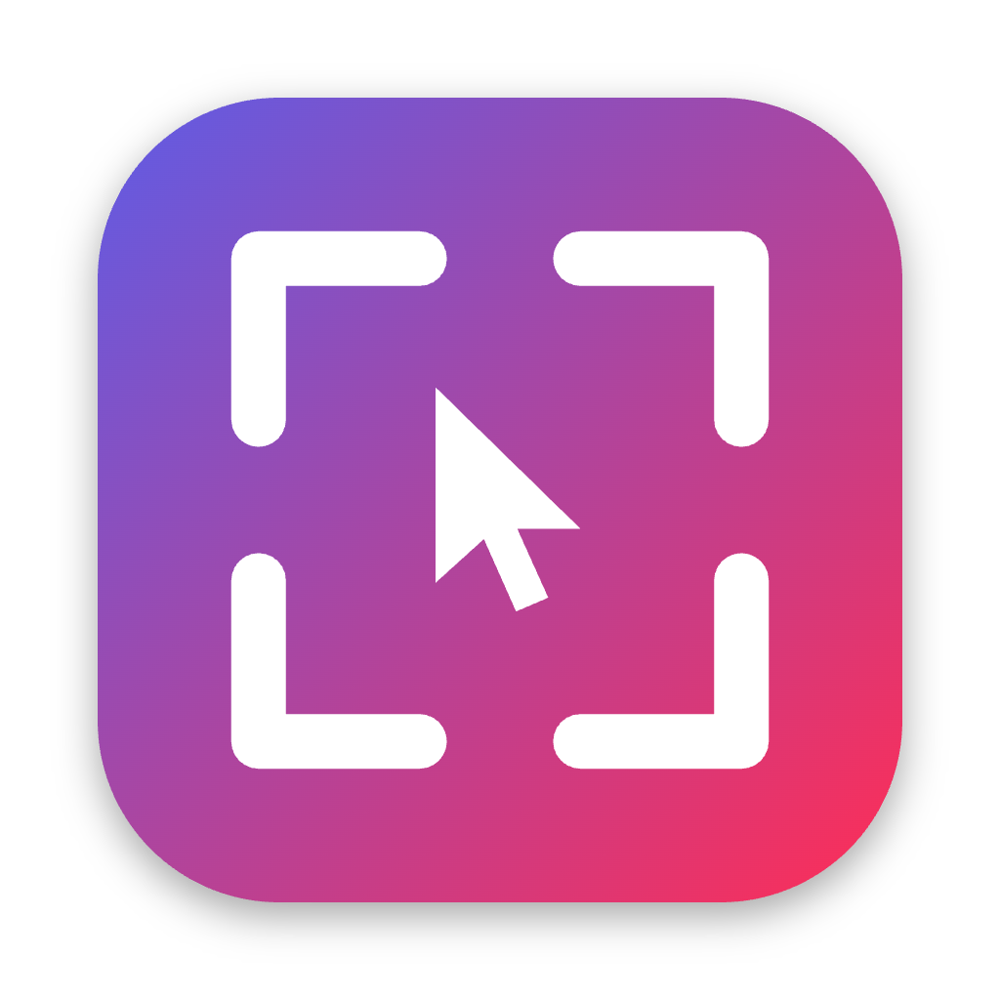
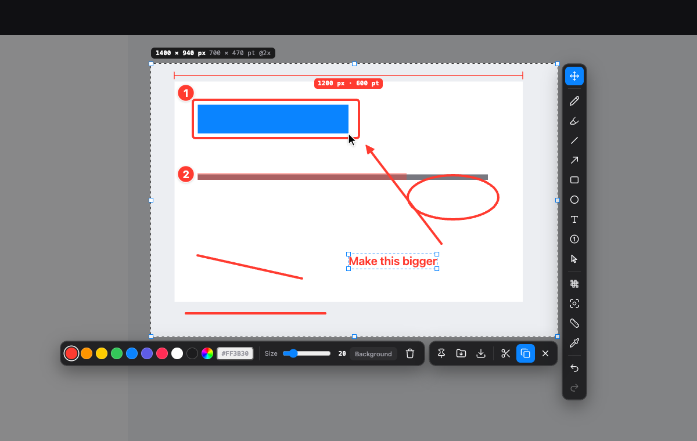

<p align="center">
  
</p>

<h1 align="center">SnapMark</h1>

<p align="center">
  A fast, private screenshot and markup tool for designers, for macOS and Windows.<br/>
  Press a hotkey, drag a region, mark it up and copy it. It works offline and uploads nothing.
</p>

<p align="center">
  <a href="https://github.com/azaanmunir/snapmark/releases/latest"><b>Download</b></a> ·
  <a href="#features">Features</a> ·
  <a href="#shortcuts">Shortcuts</a> ·
  <a href="#build-from-source">Build from source</a>
</p>

<p align="center">
  
</p>

> **Status: v0.1 beta.** It's used daily on macOS. The Windows build compiles but hasn't had much real-world testing
> yet, so bug reports are very welcome.

## Features

- **Lightshot-style flow:** a hotkey freezes the screen; drag to select, then the toolbars appear next to your selection.
- **Pixel-precise selection:** a magnifier with the HEX color under the cursor, a size badge in **px and pt**, Retina-aware
  export, arrow-key nudging, Space to reposition while dragging, Shift for a square, Alt to draw from the center.
- **Markup tools:** pen, highlighter, line, arrow, rectangle (rounded or filled), ellipse/circle, text (plain or on a
  background), **step numbers with labels**, **cursor pointers** (Mac / Classic / Color / Click ripple),
  blur and pixelate, spotlight, **measure** (distance in px and pt), and a **color picker** that copies HEX or rgb().
- **Everything stays editable** until you copy or save: select, drag, resize with handles, recolor, edit text again,
  cut/paste/duplicate, undo/redo.
- **Actions:** copy, save as PNG/JPG, quick save to a folder, and **pin** a screenshot to float above your work
  (zoom, change its opacity, drag it around).
- **Private:** no network code, no analytics, no uploads.

## Install

Download the latest installer from **[Releases](https://github.com/azaanmunir/snapmark/releases/latest)**.

| Platform | File |
|---|---|
| macOS, Apple Silicon (M1–M4) | `SnapMark-x.y.z-arm64.dmg` |
| macOS, Intel | `SnapMark-x.y.z.dmg` |
| Windows (installer) | `SnapMark Setup x.y.z.exe` |
| Windows (portable, no install) | `SnapMark x.y.z.exe` |

The builds aren't signed with a paid Apple or Microsoft certificate yet, so your OS will warn you the first time you open one:

**macOS**
1. Open the DMG and drag SnapMark into Applications.
2. Open SnapMark. If macOS blocks it, go to **System Settings → Privacy & Security**, scroll down and click
   **Open Anyway**.
3. Press **⌘⇧2**. Allow **Screen Recording** when asked (System Settings → Privacy & Security →
   Screen & System Audio Recording), then quit and reopen SnapMark.
   If SnapMark isn't in that list, click **+** and add it from Applications.
   If the switch is on but capturing still fails, remove SnapMark with **−** and add it again.

**Windows**
1. Run the installer. If SmartScreen appears, click **More info → Run anyway**.
2. Press **PrintScreen** or **Ctrl+Shift+2**. If PrintScreen opens Windows' Snipping Tool instead, turn off
   *Settings → Accessibility → Keyboard → "Use the Print screen key to open screen capture"*.

SnapMark lives in the menu bar (macOS) or the system tray (Windows). Right-click or click its icon for Settings.

## Shortcuts

| | macOS | Windows |
|---|---|---|
| Capture | ⌘⇧2 | PrintScreen / Ctrl+Shift+2 |
| Copy & close | ⌘C / Enter / double-click | Ctrl+C / Enter / double-click |
| Save as… / quick save | ⌘S / ⇧⌘S | Ctrl+S / Ctrl+Shift+S |
| Pin on screen | ⌘P | Ctrl+P |
| Cut / paste / duplicate shape | ⌘X / ⌘V / ⌘D | Ctrl+X / Ctrl+V / Ctrl+D |
| Undo / redo | ⌘Z / ⇧⌘Z | Ctrl+Z / Ctrl+Y |
| Cancel | Esc | Esc |

**Tools:** V move · P pen · M highlighter · L line · A arrow · R rectangle · E ellipse · T text · N step number ·
U pointer · B blur · F spotlight · D measure · I color picker · C copies the HEX under the cursor (Shift+C copies rgb()).

**Editing:** with the Text, Step number or Pointer tool, click an item to select it, drag to move it, click again to edit
its text, and drag a corner to resize it. Color and size changes apply to the selected item, or live while you're typing.

**Pins:** drag to move · scroll or pinch to zoom · Alt+scroll changes opacity · double-click resets to 100% ·
right-click opens a menu · Esc closes.

All hotkeys, the save folder, the file-name pattern, PNG/JPG and 2×/1× export can be changed in **Settings**.

## Build from source

Requires [Node.js](https://nodejs.org) 20+.

```bash
git clone https://github.com/azaanmunir/snapmark.git
cd snapmark
npm install
npm start               # run in development (the tray icon appears)
npm test                # headless smoke test of the capture overlay
npm run dist:mac        # build .dmg files (on macOS)
npm run dist:win        # build Windows installer + portable .exe
```

Developer notes (architecture, gotchas, how to add a tool) are in [CLAUDE.md](CLAUDE.md). The roadmap and change log
are in [PROGRESS.md](PROGRESS.md).

## Contributing

Issues and pull requests are welcome. Good first contributions:
- testing on Windows and multi-monitor setups,
- window snapping on hover,
- a capture history panel.

Please run `npm run check && npm test` before opening a PR.

## Acknowledgements

Inspired by the workflow of [Lightshot](https://app.prntscr.com/), [ShareX](https://github.com/ShareX/ShareX),
[Flameshot](https://github.com/flameshot-org/flameshot) and Snipaste. SnapMark is an independent project; it isn't
affiliated with any of them and contains none of their code. It's built with [Electron](https://www.electronjs.org/).

## License

[MIT](LICENSE) © 2026 Azaan Ali
